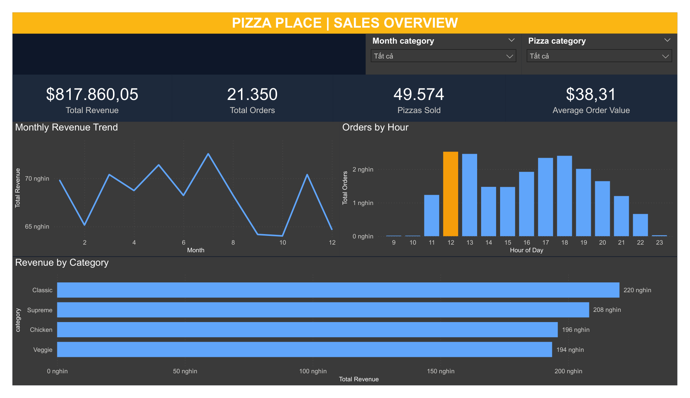
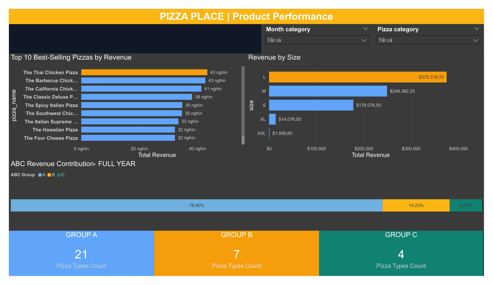
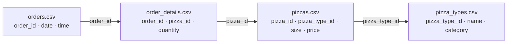

# Pizza Place Sales Analysis | Phân tích doanh thu bán pizza

Dự án cá nhân phân tích doanh thu bán pizza năm **2015**, sử dụng **SQL Server (T-SQL)** để kiểm tra, chuẩn hóa và phân tích dữ liệu, kết hợp **Power BI** để trực quan hóa kết quả và tạo bộ lọc tương tác.

> **Phạm vi:** phân tích doanh thu, số lượng bán và nhu cầu đặt hàng; **không phân tích lợi nhuận** do bộ dữ liệu không có thông tin giá vốn/chi phí.

## Dashboard

### 1. Sales Overview



Thể hiện doanh thu, số đơn, số pizza, AOV, xu hướng theo tháng, giờ cao điểm và cơ cấu doanh thu theo danh mục.

### 2. Product Performance



Gồm top 10 sản phẩm theo doanh thu, doanh thu theo kích cỡ và phân tích ABC cố định cho cả năm 2015.

**Xem dashboard:** [PDF 2 trang](powerbi/Pizza_Sales_Dashboard_New.pdf) · [File Power BI (.pbix)](powerbi/Pizza_Sales_Dashboard_New.pbix)

## Chỉ số tổng quan

| KPI | Kết quả 2015 |
|---|---:|
| Tổng doanh thu | **817.860,05 USD** |
| Tổng đơn hàng duy nhất | **21.350** |
| Tổng số pizza bán ra | **49.574** |
| Giá trị đơn hàng trung bình (AOV) | **38,31 USD** |
| Số dòng chi tiết đơn hàng | **48.620** |

## Dữ liệu nguồn (CSV)

Bộ dữ liệu được lưu trong thư mục [`data/`](data/) với **4 tệp CSV**. Mỗi tệp tương ứng với một bảng trong SQL Server:

| Tệp | Bảng SQL Server | Các trường chính sử dụng | Vai trò |
|---|---|---|---|
| [`orders.csv`](data/orders.csv) | `dbo.orders` | `order_id`, `date`, `time` | Thông tin thời điểm đặt hàng; mỗi dòng là một đơn hàng. |
| [`order_details.csv`](data/order_details.csv) | `dbo.order_details` | `order_details_id`, `order_id`, `pizza_id`, `quantity` | Chi tiết sản phẩm và số lượng trong từng đơn hàng. |
| [`pizzas.csv`](data/pizzas.csv) | `dbo.pizzas` | `pizza_id`, `pizza_type_id`, `size`, `price` | Mã sản phẩm theo kích cỡ và đơn giá. |
| [`pizza_types.csv`](data/pizza_types.csv) | `dbo.pizza_types` | `pizza_type_id`, `name`, `category` | Tên sản phẩm và nhóm pizza (Classic, Supreme, Chicken, Veggie). |

**Quan hệ giữa các bảng:** `orders.order_id` → `order_details.order_id`; `order_details.pizza_id` → `pizzas.pizza_id`; `pizzas.pizza_type_id` → `pizza_types.pizza_type_id`.



Kết quả kiểm tra SQL ghi nhận **21.350 đơn hàng**, **48.620 dòng chi tiết**, **96 SKU** và **32 loại pizza** trong bộ dữ liệu phân tích. Khi sử dụng một bản dữ liệu khác, cần chạy lại truy vấn kiểm tra thay vì mặc định các con số này.

> **Lưu ý khi nhập CSV:** Giữ nguyên bốn file nguồn; kiểm tra kiểu dữ liệu của `date`, `time`, `quantity` và đặc biệt là **dấu thập phân trong `pizzas.price`**. Trong lần import thực hành, một số đơn giá mất dấu thập phân, nên dự án sử dụng VIEW để chuẩn hóa và kiểm tra lại mà không sửa dữ liệu nguồn. Xem [ghi chú SQL](docs/GHI_CHU_SQL.md) và [hướng dẫn dữ liệu](data/README.md).

## Vấn đề chất lượng dữ liệu đã giải quyết

Trong quá trình nhập dữ liệu vào SQL Server, phát hiện **74 trong 96 SKU** có đơn giá mang hệ số không hợp lý do mất dấu thập phân. Vì các giá không sai theo cùng một tỷ lệ, dự án tạo VIEW `vw_pizza_prices_clean_v2` và chuẩn hóa theo từng trường hợp, **không ghi đè bảng gốc**.

Sau đó, tổng doanh thu tính được là **817.860,05 USD**, khớp số liệu tham chiếu, chênh lệch 0,00. Các kiểm tra bổ sung cho thấy không có dòng doanh thu âm/trống, giá chuẩn hóa không hợp lệ hoặc dòng chi tiết thiếu khóa giá.

> **Giới hạn:** cần đối chiếu đủ **96 đơn giá với `pizzas.csv` gốc** trước khi khẳng định mọi SKU đều chính xác. Việc khớp KPI tổng chưa thay thế bước kiểm tra ở cấp sản phẩm.

## Các phát hiện chính

1. **Tháng 7** là tháng có doanh thu cao nhất (**72.557,90 USD**); thấp nhất là tháng 10 (**64.027,60 USD**).
2. **12 giờ trưa** có nhiều đơn nhất trong năm (**2.520 đơn**).
3. **Classic** đứng đầu về doanh thu danh mục (**220.053,10 USD; 26,91%**).
4. **The Thai Chicken Pizza** là loại pizza có doanh thu cao nhất (**43.434,25 USD**).
5. **Size L** đóng góp **45,89% doanh thu**.
6. Nhóm sản phẩm **A gồm 21/32 loại pizza**, đóng góp **78,90% doanh thu** theo phương pháp phân nhóm ABC sử dụng trong dự án.

Đọc đầy đủ: [Phân tích kinh doanh và đề xuất](docs/PHAN_TICH_VA_DE_XUAT.md).

## Quy trình thực hiện

**Dữ liệu nguồn → Kiểm tra chất lượng → Chuẩn hóa đơn giá → Truy vấn T-SQL → Đối chiếu KPI → Power BI → Nhận xét và đề xuất.**

Các công cụ chính: SQL Server, SSMS, CTE, Window Functions (`LAG`, `DENSE_RANK`, `SUM OVER`), Power BI, DAX.

## Cấu trúc mã nguồn

```text
Pizza-Place-Sales-Analysis/
├── README.md
├── sql/
│   ├── 01_kiem_tra_chat_luong_du_lieu.sql
│   ├── 02_chuan_hoa_don_gia.sql
│   ├── 03_phan_tich_kinh_doanh_nang_cao.sql
│   └── 04_tao_view_cho_power_bi.sql
├── powerbi/
│   ├── Pizza_Sales_Dashboard_New.pbix
│   └── Pizza_Sales_Dashboard_New.pdf
├── images/
│   ├── sales_overview.png
│   └── product_performance.png
├── docs/
│   ├── GHI_CHU_SQL.md
│   ├── GHI_CHU_POWER_BI.md
│   ├── CAC_CONG_THUC_DAX.md
│   └── PHAN_TICH_VA_DE_XUAT.md
└── data/
    ├── orders.csv
    ├── order_details.csv
    ├── pizzas.csv
    ├── pizza_types.csv
    └── README.md
```

## Cách tái lập

1. Đặt đủ 4 file CSV gốc trong thư mục `data/`: `orders.csv`, `order_details.csv`, `pizzas.csv`, `pizza_types.csv`.
2. Tạo database `Pizza_Sales_DB` trong SQL Server và nhập các CSV thành bốn bảng `dbo.orders`, `dbo.order_details`, `dbo.pizzas`, `dbo.pizza_types` (giữ đúng tên cột và quan hệ).
3. Kiểm tra dữ liệu import, nhất là `pizzas.price` và định dạng ngày/giờ. Chạy lần lượt các file **`sql/01` → `sql/02` → `sql/03` → `sql/04`** bằng SSMS. Nếu dùng tên database khác, sửa câu lệnh `USE` trong script.
4. Đối chiếu với KPI năm 2015: **21.350 đơn**, **49.574 pizza**, **817.860,05 USD doanh thu** và **48.620 dòng chi tiết**. Nếu sai, kiểm tra import trước khi tạo báo cáo.
5. Mở [`powerbi/Pizza_Sales_Dashboard_New.pbix`](powerbi/Pizza_Sales_Dashboard_New.pbix), cấu hình lại nguồn SQL Server cho máy đang dùng và tải dữ liệu từ VIEW `dbo.vw_PizzaSales_Master_Clean`.

Chi tiết: [Ghi chú và hướng dẫn SQL](docs/GHI_CHU_SQL.md) · [Ghi chú Power BI](docs/GHI_CHU_POWER_BI.md) · [Tổng hợp DAX](docs/CAC_CONG_THUC_DAX.md).

## Lưu ý diễn giải

- Khi lọc danh mục, AOV phản ánh doanh thu của danh mục được chọn chia số đơn chứa danh mục đó.
- Biểu đồ xu hướng tháng có thể giữ đủ 12 tháng khi chọn một tháng ở slicer.
- ABC là phân loại toàn năm 2015, không thay đổi theo slicer.
- Định dạng/nguồn dữ liệu khác có thể làm sai kết quả nếu không kiểm tra chất lượng trước khi phân tích.

## Nguồn dữ liệu

Sử dụng bộ dữ liệu **Pizza Place Sales** cho mục đích học tập, gồm bốn CSV lưu trong [`data/`](data/). Quyền sở hữu dữ liệu không thuộc tác giả dự án. 
